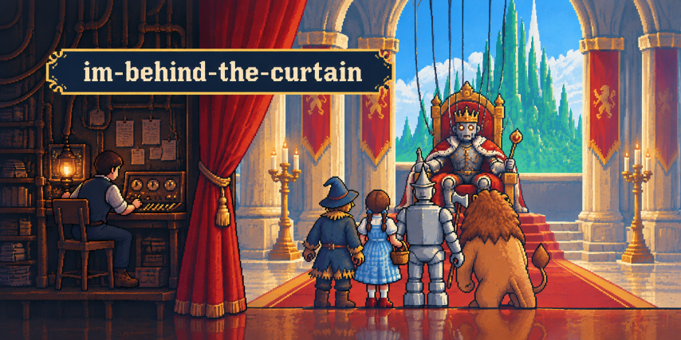

# im-behind-the-curtain



人間がLLMの代わりに返答を書くAPIサーバーです。サーバーはリクエストを受け取るとファイルに書き出し、人間が返答を書くと、それをレスポンスとして返します。本物のモデルなしでLLMクライアントの動きを確かめたいとき、また、自分がAIの役をしたいときに使えます。

[English](README.md)

## インストール

Node.js 24以降が必要です。

```sh
npm install --global imbehind
```

## 使い方

1つの端末でサーバーを、別の端末で返答の画面を起動します。

```sh
imbehind serve    # http://127.0.0.1:3000 でAPIを起動する
imbehind answer   # リクエストを表示して、返答を打ち込む
```

3つ目の端末からリクエストを送ります。

```sh
curl http://127.0.0.1:3000/v1/chat/completions \
  -H 'Content-Type: application/json' \
  -d '{"model":"whatever","messages":[{"role":"user","content":"Hello"}]}'
```

`imbehind answer` がリクエストを表示します。返答を打ち込み、Ctrl+D で終えます（Windowsでは Ctrl+Z のあとにEnter）。`curl` には、打ち込んだ文章が入ったChat Completions形式のレスポンスが返ります。`imbehind path` は、ファイルの保存先を表示します。

## 対応していること

- Chat Completions形式の `POST /v1/chat/completions`。文章のメッセージ、構造化出力のためのJSONの返答、ストリーミングに対応します。モデル名とAPIキーは何でも構いません。
- `GET /v1/models`。
- ツール: `tools` や `functions` を持つ依頼と、`tool_calls`、`function_call`、ロール `tool` と `function` を持つメッセージは、保存して表示します。ツールを呼ばせたいときは、返答としてツール呼び出しのJSON配列を打ち込みます。クライアントには `tool_calls`（`functions` だけを送ったときは `function_call`）が返り、ストリームでも同じです。それ以外の返答は文章として返します。書き方は[仕様書](https://github.com/two-pack/im-behind-the-curtain/blob/main/docs/specification.md)（英語）にあります。
- 文章でない部品（画像、音声、ファイル）は、`code` が `unsupported_content` の `400` エラーで断ります。保存しません。

サーバーは、返答を既定で30分待ちます。クライアントのタイムアウトを同じかそれ以上にし、自動の再試行は切ってください。そうしないと、クライアントが先にあきらめて、同じ依頼をもう一度送ることがあります。[仕様書](https://github.com/two-pack/im-behind-the-curtain/blob/main/docs/specification.md)（英語）に、公式SDKでの設定例、すべての設定、サーバーが書くファイルがあります。

## 注意

- 送ったものはすべてファイルに保存され、人間が読みます。断った依頼（画像つきなど）は保存しません。
- 認証はなく、サーバーは手元のアドレスでだけ待ち受けます。自分のマシンの上でだけ使ってください。
- OpenAI、Anthropicほか、名前を挙げた各社とは関係ありません。

## 文書

- [仕様書](https://github.com/two-pack/im-behind-the-curtain/blob/main/docs/specification.md)（英語）: プログラムの動きの詳細
- [保存形式](https://github.com/two-pack/im-behind-the-curtain/blob/main/docs/storage-format.md)（英語）: 依頼と返答のファイル
- [要求](https://github.com/two-pack/im-behind-the-curtain/blob/main/docs/requirements.md)（英語）: 最初の版が満たすこと
- [参加の手引き](https://github.com/two-pack/im-behind-the-curtain/blob/main/docs/contributing.md)（英語）: ビルド、テスト、変更の送り方

## ライセンス

MIT
